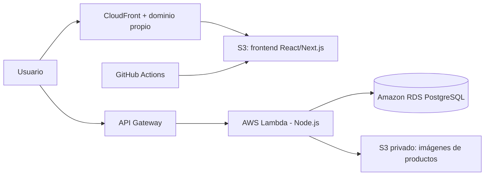

# Arquitectura en AWS

## Diagrama

## Componentes

| Servicio | Función |
|----------|---------|
| Amazon S3 (frontend) | Aloja los archivos estáticos generados por Next.js (out/) |
| CloudFront | Entrega el sitio por HTTPS con el dominio personalizado |
| API Gateway | Expone la API REST al frontend |
| AWS Lambda | Ejecuta la lógica del backend en Node.js |
| Amazon RDS (PostgreSQL) | Guarda usuarios e inventarios |
| S3 privado | Guarda las imágenes de los productos |
| GitHub Actions | Compila y despliega el frontend en S3 |
